# CPQ Agent Orchestration: Handoff Map

> Comprehensive mapping of all agent-to-agent handoffs across the 37-agent CPQ system.
> This document describes the data flow, dependency graph, communication patterns,
> and value chain stages that govern how agents collaborate to move a deal from
> initial product selection through fulfillment and renewal.

---

## Agent Cross-Reference Table

| Agent ID | Functional Title | PRD File | Java Class | Package | Group |
|----------|-----------------|----------|------------|---------|-------|
| cpq-agent-001 | Guided Product Selection | `guided-product-selection.md` | `GuidedProductSelectionAgent` | `agent.product` | Product Configuration |
| cpq-agent-002 | Option & Feature Configuration | `option-feature-configuration.md` | `OptionFeatureConfigurationAgent` | `agent.product` | Product Configuration |
| cpq-agent-003 | Bundle Assembly | `bundle-assembly.md` | `BundleAssemblyAgent` | `agent.product` | Product Configuration |
| cpq-agent-004 | List Price Application | `list-price-application.md` | `ListPriceApplicationAgent` | `agent.pricing` | Pricing - Base |
| cpq-agent-005 | Pricing Method | `pricing-method.md` | `PricingMethodAgent` | `agent.pricing` | Pricing - Base |
| cpq-agent-006 | Markup & Cost Integration | `markup-cost-integration.md` | `MarkupCostIntegrationAgent` | `agent.pricing` | Pricing - Base |
| cpq-agent-007 | Volume Discount | `volume-discount.md` | `VolumeDiscountAgent` | `agent.pricing` | Pricing - Discounts |
| cpq-agent-008 | Customer Segment Discount | `customer-segment-discount.md` | `CustomerSegmentDiscountAgent` | `agent.pricing` | Pricing - Discounts |
| cpq-agent-009 | Promotional Campaign | `promotional-campaign.md` | `PromotionalCampaignAgent` | `agent.pricing` | Pricing - Discounts |
| cpq-agent-010 | Deal-Specific Discount | `deal-specific-discount.md` | `DealSpecificDiscountAgent` | `agent.pricing` | Pricing - Discounts |
| cpq-agent-011 | Minimum Margin Enforcement | `minimum-margin-enforcement.md` | `MinimumMarginEnforcementAgent` | `agent.pricing` | Pricing - Guardrails |
| cpq-agent-012 | Profitability Alert | `profitability-alert.md` | `ProfitabilityAlertAgent` | `agent.pricing` | Pricing - Guardrails |
| cpq-agent-013 | Product SKU Management | `product-sku-management.md` | `ProductSkuManagementAgent` | `agent.product` | Product Catalog Management |
| cpq-agent-014 | Attribute & Feature Catalog | `attribute-feature-catalog.md` | `AttributeFeatureCatalogAgent` | `agent.product` | Product Catalog Management |
| cpq-agent-015 | Compatibility Rules | `compatibility-rules.md` | `CompatibilityRulesAgent` | `agent.product` | Product Catalog Management |
| cpq-agent-016 | Validation Rules | `validation-rules.md` | `ValidationRulesAgent` | `agent.product` | Product Catalog Management |
| cpq-agent-017 | Recommendation & Upsell | `recommendation-upsell.md` | `RecommendationUpsellAgent` | `agent.intelligence` | Intelligent Selling |
| cpq-agent-018 | Dynamic Bundle Pricing | `dynamic-bundle-pricing.md` | `DynamicBundlePricingAgent` | `agent.pricing` | Intelligent Selling |
| cpq-agent-019 | SaaS Tier Pricing | `saas-tier-pricing.md` | `SaasTierPricingAgent` | `agent.subscription` | Subscription & Licensing |
| cpq-agent-020 | Term & Co-Terming | `term-coterming.md` | `TermCotermingAgent` | `agent.subscription` | Subscription & Licensing |
| cpq-agent-021 | Usage-Based Pricing | `usage-based-pricing.md` | `UsageBasedPricingAgent` | `agent.subscription` | Subscription & Licensing |
| cpq-agent-022 | Perpetual License | `perpetual-license.md` | `PerpetualLicenseAgent` | `agent.subscription` | Subscription & Licensing |
| cpq-agent-023 | Maintenance & Support Fee | `maintenance-support-fee.md` | `MaintenanceSupportFeeAgent` | `agent.subscription` | Subscription & Licensing |
| cpq-agent-024 | Multi-Level Approval Routing | `multilevel-approval-routing.md` | `MultiLevelApprovalRoutingAgent` | `agent.governance` | Governance & Approvals |
| cpq-agent-025 | Exception Handling | `exception-handling.md` | `ExceptionHandlingAgent` | `agent.governance` | Governance & Approvals |
| cpq-agent-026 | Win-Probability Analysis | `win-probability-analysis.md` | `WinProbabilityAnalysisAgent` | `agent.intelligence` | Analytics & Intelligence |
| cpq-agent-027 | Margin Optimization | `margin-optimization.md` | `MarginOptimizationAgent` | `agent.intelligence` | Analytics & Intelligence |
| cpq-agent-028 | Renewal Opportunity Detection | `renewal-opportunity-detection.md` | `RenewalOpportunityDetectionAgent` | `agent.intelligence` | Analytics & Intelligence |
| cpq-agent-029 | Upgrade/Downgrade Path | `upgrade-downgrade-path.md` | `UpgradeDowngradePathAgent` | `agent.intelligence` | Analytics & Intelligence |
| cpq-agent-030 | Contract Lifecycle Management | `contract-lifecycle-management.md` | `ContractLifecycleManagementAgent` | `agent.governance` | Integration & Operations |
| cpq-agent-031 | Quote Document Generation | `quote-document-generation.md` | `QuoteDocumentGenerationAgent` | `agent.governance` | Integration & Operations |
| cpq-agent-032 | Currency & FX Management | `currency-fx-management.md` | `CurrencyFxManagementAgent` | `agent.governance` | Integration & Operations |
| cpq-agent-033 | Tax Calculation Integration | `tax-calculation-integration.md` | `TaxCalculationIntegrationAgent` | `agent.governance` | Integration & Operations |
| cpq-agent-034 | Competitive Pricing Intelligence | `competitive-pricing-intelligence.md` | `CompetitivePricingIntelligenceAgent` | `agent.governance` | Integration & Operations |
| cpq-agent-035 | Price Book Management | `price-book-management.md` | `PriceBookManagementAgent` | `agent.governance` | Integration & Operations |
| cpq-agent-036 | Audit & Compliance Reporting | `audit-compliance-reporting.md` | `AuditComplianceReportingAgent` | `agent.governance` | Integration & Operations |
| cpq-agent-037 | Deal Desk Workflow Orchestration | `deal-desk-workflow-orchestration.md` | `DealDeskWorkflowOrchestrationAgent` | `agent.governance` | Integration & Operations |

> **Note:** All Java classes reside under `com.opencrm.ai.agent.*` in
> `backend/services/ai-service/src/main/java/com/opencrm/ai/agent/`.
> All agents implement the `CpqAgent` interface and are registered as Spring `@Service` beans
> keyed by agent ID in the `AgentRouter`.

---

## Lead-to-Fulfillment Flow Diagram

```mermaid
flowchart TD
    subgraph CONFIGURE["CONFIGURE"]
        A001["001: Guided Product\nSelection\n(ENTRY POINT)"]
        A002["002: Option & Feature\nConfiguration"]
        A003["003: Bundle Assembly"]
        A013["013: Product SKU\nManagement"]
        A014["014: Attribute &\nFeature Catalog"]
        A015["015: Compatibility\nRules"]
        A016["016: Validation Rules"]
    end

    subgraph PRICE["PRICE"]
        A004["004: List Price\nApplication"]
        A005["005: Pricing Method"]
        A006["006: Markup & Cost\nIntegration"]
        A007["007: Volume Discount"]
        A008["008: Customer Segment\nDiscount"]
        A009["009: Promotional\nCampaign"]
        A010["010: Deal-Specific\nDiscount"]
        A011["011: Minimum Margin\nEnforcement\n(GUARDRAIL)"]
        A012["012: Profitability Alert"]
        A018["018: Dynamic Bundle\nPricing"]
        A019["019: SaaS Tier Pricing"]
        A020["020: Term & Co-Terming"]
        A021["021: Usage-Based Pricing"]
        A022["022: Perpetual License"]
        A023["023: Maintenance &\nSupport Fee"]
        A032["032: Currency & FX\nManagement"]
        A033["033: Tax Calculation\nIntegration"]
        A035["035: Price Book\nManagement"]
    end

    subgraph QUOTE["QUOTE"]
        A031["031: Quote Document\nGeneration"]
        A017["017: Recommendation\n& Upsell"]
        A026["026: Win-Probability\nAnalysis"]
        A034["034: Competitive Pricing\nIntelligence"]
    end

    subgraph APPROVE["APPROVE"]
        A024["024: Multi-Level\nApproval Routing"]
        A025["025: Exception\nHandling"]
        A037["037: Deal Desk Workflow\nOrchestration\n(PRIMARY ORCHESTRATOR)"]
        A027["027: Margin\nOptimization"]
        A036["036: Audit &\nCompliance"]
    end

    subgraph FULFILL["FULFILL"]
        A030["030: Contract Lifecycle\nManagement"]
    end

    subgraph RENEW["RENEW"]
        A028["028: Renewal Opportunity\nDetection"]
        A029["029: Upgrade/Downgrade\nPath"]
    end

    %% === QUOTE CREATION FLOW ===
    A001 -->|"product selected"| A002
    A001 -->|"product selected"| A004
    A001 -->|"product context"| A017
    A002 -->|"configured product"| A003
    A002 -->|"config for validation"| A016
    A003 -->|"bundle ready"| A018

    %% Catalog support
    A013 -->|"SKU data"| A014
    A013 -->|"SKU data"| A015
    A015 -->|"rules"| A016

    %% === PRICING FLOW ===
    A004 -->|"list price"| A005
    A004 -->|"list price"| A006
    A004 -->|"list price"| A007
    A004 -->|"list price"| A009
    A004 -->|"list price"| A019
    A004 -->|"list price"| A020
    A004 -->|"list price"| A021
    A004 -->|"list price"| A022
    A004 -->|"list price"| A032
    A004 -->|"list price"| A033
    A004 -->|"list price"| A035
    A003 -->|"bundle context"| A018
    A005 -->|"method applied"| A006
    A007 -->|"volume tier"| A008
    A022 -->|"license price"| A023

    %% === GUARDRAIL FLOW ===
    A006 -->|"cost+markup"| A011
    A006 -->|"cost+markup"| A012
    A011 -->|"margin gated"| A010
    A006 -->|"margin data"| A027
    A011 -->|"margin data"| A027

    %% === APPROVAL FLOW ===
    A011 -->|"price finalized"| A024
    A024 -->|"exception needed"| A025
    A024 -->|"approval context"| A037
    A025 -->|"exception resolved"| A037
    A031 -->|"doc context"| A037
    A011 -->|"audit trail"| A036
    A024 -->|"audit trail"| A036

    %% === DOCUMENT GENERATION FLOW ===
    A024 -->|"approved quote"| A031

    %% === FULFILLMENT FLOW ===
    A024 -->|"approved quote"| A030

    %% === RENEWAL FLOW ===
    A028 -->|"renewal detected"| A029
    A029 -.->|"re-enter pricing"| A019
    A029 -.->|"re-enter pricing"| A022
    A029 -.->|"re-enter pricing"| A023
    A029 -.->|"re-enter pricing"| A020

    %% === EVENT-DRIVEN (Redis Pub/Sub) ===
    A030 -.->|"quote:accepted\n(Redis Pub/Sub)"| A028

    %% Styling
    style A001 fill:#4CAF50,color:#fff
    style A011 fill:#F44336,color:#fff
    style A037 fill:#FF9800,color:#fff
```



---

## Handoff Matrix

The table below lists every agent, its upstream sources (who hands off TO this agent),
its downstream targets (who this agent hands off TO), and the trigger type.

| Agent ID | Agent Name | Upstream (receives from) | Downstream (hands off to) | Trigger / Event Type |
|----------|-----------|-------------------------|--------------------------|---------------------|
| **001** | Guided Product Selection | -- (Entry point: user/UI) | 002, 004, 017 | User initiates quote; product search request |
| **002** | Option & Feature Configuration | 001 | 003, 016 | Product selected; configuration needed |
| **003** | Bundle Assembly | 001, 002 | 018 | Configured products ready for bundling |
| **004** | List Price Application | 001 | 005, 006, 007, 008, 009, 019, 020, 021, 022, 032, 033, 035 | Product confirmed; fetch base price |
| **005** | Pricing Method | 004 | 006 | List price resolved; method selection |
| **006** | Markup & Cost Integration | 004, 005 | 011, 012, 027 | Pricing method applied; cost overlay needed |
| **007** | Volume Discount | 004 | 008 | List price available; volume tiers evaluated |
| **008** | Customer Segment Discount | 004, 007 | -- (feeds into combined discount stack) | Volume discount resolved; segment rules applied |
| **009** | Promotional Campaign | 004 | -- (feeds into combined discount stack) | List price available; active promos checked |
| **010** | Deal-Specific Discount | 004, 011 | -- (feeds into combined discount stack) | Margin-gated; rep requests deal-level discount |
| **011** | Minimum Margin Enforcement | 006 | 010, 024, 027, 036 | Cost+markup computed; margin floor check (salience 930) |
| **012** | Profitability Alert | 006 | -- (advisory notification to rep) | Cost+markup computed; profitability analysis |
| **013** | Product SKU Management | -- (catalog admin) | 014, 015 | SKU created/updated; catalog maintenance |
| **014** | Attribute & Feature Catalog | 013 | -- (catalog reference) | SKU changes propagated; attribute sync |
| **015** | Compatibility Rules | 013 | 016 | SKU changes; rule updates |
| **016** | Validation Rules | 002, 015 | -- (blocks/allows config) | Configuration submitted; compatibility check |
| **017** | Recommendation & Upsell | 001 | -- (advisory to rep during quoting) | Product context available; upsell analysis |
| **018** | Dynamic Bundle Pricing | 003, 004 | -- (bundle price resolved) | Bundle assembled + list prices available |
| **019** | SaaS Tier Pricing | 004 | 020 | List price for SaaS product; tier determination |
| **020** | Term & Co-Terming | 004 | -- (term-adjusted price) | Subscription price resolved; term alignment |
| **021** | Usage-Based Pricing | 004 | -- (metered price) | List price available; usage model applied |
| **022** | Perpetual License | 004 | 023 | List price available; license pricing |
| **023** | Maintenance & Support Fee | 022 | -- (support fee calculated) | License price resolved; support % applied |
| **024** | Multi-Level Approval Routing | 011 | 025, 030, 031, 036, 037 | Price finalized and margin-validated; approval workflow starts |
| **025** | Exception Handling | 024 | 037 | Approval triggers exception; escalation needed |
| **026** | Win-Probability Analysis | -- (invoked on demand) | -- (advisory to rep) | Quote in review; predictive scoring |
| **027** | Margin Optimization | 006, 011 | -- (advisory recommendations) | Margin data available; optimization suggestions |
| **028** | Renewal Opportunity Detection | -- (event: `quote:accepted` via Redis) | 029 | Contract approaching expiry; renewal scanned |
| **029** | Upgrade/Downgrade Path | 028 | 019, 020, 022, 023 (re-enters pricing) | Renewal detected; path options generated |
| **030** | Contract Lifecycle Management | 024 | 028 (via Redis `quote:accepted`) | Quote approved; contract created |
| **031** | Quote Document Generation | 024 | 037 | Quote approved; PDF/document generation |
| **032** | Currency & FX Management | 004 | -- (currency-converted price) | Multi-currency deal; FX rates applied |
| **033** | Tax Calculation Integration | 004 | -- (tax-inclusive price) | Price resolved; tax jurisdiction lookup |
| **034** | Competitive Pricing Intelligence | -- (invoked on demand) | -- (advisory) | Rep requests competitive analysis |
| **035** | Price Book Management | 004 | -- (price book reference) | Price book lookup for customer/segment |
| **036** | Audit & Compliance Reporting | 011, 024 | -- (audit log) | Margin enforcement or approval event; compliance record |
| **037** | Deal Desk Workflow Orchestration | 024, 025, 031 | -- (orchestrates final deal flow) | PRIMARY ORCHESTRATOR: coordinates approval, exception, and document flows |

---

## Communication Patterns

### 1. Direct Invocation (Synchronous)

The primary communication pattern. An upstream agent calls a downstream agent via the
`AgentRouter` REST API or directly through Spring dependency injection.

```
POST /api/v1/ai/agents/{agentId}/invoke
POST /api/v1/ai/agents/{agentId}/stream   (SSE for streaming responses)
```

All 37 agents are registered as `@Service` beans implementing `CpqAgent` and collected
into `AgentRouter.agentRegistry` keyed by agent ID. Any agent (or service) can invoke
another agent by posting to its `/invoke` endpoint with an `AgentRequest` payload.

**Session state** is persisted in Redis via `RedisStateManager` under the key pattern
`ai:session:{sessionId}` with a 24-hour TTL, allowing multi-step agent chains to share
context across invocations.

**Applies to:** All dependency edges in the Handoff Matrix above (001->002, 004->005, etc.)

### 2. Event-Driven (Redis Pub/Sub)

Asynchronous, decoupled communication for cross-service events that do not require
an immediate response.

| Channel | Publisher | Subscriber | Payload |
|---------|-----------|-----------|---------|
| `quote:accepted` | `QuoteEventPublisher` (quote-service) | `QuoteAcceptedEventListener` (crm-service) | `QuoteAcceptedEvent` (quote number, customer, line items) |

The `quote:accepted` channel bridges the fulfillment boundary: when a quote is accepted
and a contract created (Agent 030), the event fires and is consumed by the renewal
detection pipeline (Agent 028), closing the renew loop.

**Configuration:**
- Publisher: `QuoteEventPublisher` in `quote-service` uses `StringRedisTemplate.convertAndSend()`
- Subscriber: `RedisSubscriberConfig` in `crm-service` registers a `RedisMessageListenerContainer`
  on `ChannelTopic("quote:accepted")`

### 3. Orchestrator Pattern

Agent 037 (Deal Desk Workflow Orchestration) acts as the **primary orchestrator** for the
post-pricing phase. It does not own business logic itself but coordinates the execution
sequence of:

```
024 (Approval Routing) --> 025 (Exception Handling) --> 031 (Document Generation)
                                                    --> 030 (Contract Lifecycle)
```

The orchestrator ensures that:
- Exceptions are resolved before documents are generated
- All approval levels are satisfied before contract creation
- Audit trails (036) are populated at each gate
- The deal desk team has a single pane of glass for the entire approval-to-fulfillment flow

---

## Value Chain Stages

Each agent maps to one of six stages in the CPQ value chain:

### Stage 1: Configure

Select products, configure options, assemble bundles, and validate compatibility.

| Agent | Role |
|-------|------|
| 001 - Guided Product Selection | Entry point; product search and recommendation |
| 002 - Option & Feature Configuration | Configure selected product options |
| 003 - Bundle Assembly | Assemble multi-product bundles |
| 013 - Product SKU Management | Maintain SKU catalog (back-office) |
| 014 - Attribute & Feature Catalog | Maintain attribute definitions (back-office) |
| 015 - Compatibility Rules | Define product compatibility constraints (back-office) |
| 016 - Validation Rules | Enforce configuration validity at submission |

### Stage 2: Price

Apply list prices, discounts, markups, taxes, currency conversion, and margin guardrails.

| Agent | Role |
|-------|------|
| 004 - List Price Application | Resolve base list price from price book |
| 005 - Pricing Method | Select pricing strategy (flat, tiered, etc.) |
| 006 - Markup & Cost Integration | Apply cost basis and markup |
| 007 - Volume Discount | Apply volume-based discount tiers |
| 008 - Customer Segment Discount | Apply segment-specific discounts |
| 009 - Promotional Campaign | Apply active promotional discounts |
| 010 - Deal-Specific Discount | Apply rep-negotiated deal discounts (margin-gated) |
| 011 - Minimum Margin Enforcement | Final guardrail: enforce margin floor (salience 930) |
| 012 - Profitability Alert | Advisory: alert rep to low-margin scenarios |
| 018 - Dynamic Bundle Pricing | Compute bundle-level pricing |
| 019 - SaaS Tier Pricing | Compute SaaS subscription tier pricing |
| 020 - Term & Co-Terming | Align subscription terms and co-term dates |
| 021 - Usage-Based Pricing | Compute metered/usage pricing |
| 022 - Perpetual License | Compute perpetual license pricing |
| 023 - Maintenance & Support Fee | Compute support fees on license base |
| 032 - Currency & FX Management | Convert prices to deal currency |
| 033 - Tax Calculation Integration | Calculate applicable taxes |
| 035 - Price Book Management | Manage and resolve price book entries |

### Stage 3: Quote

Generate the quote document and provide intelligence to strengthen the deal.

| Agent | Role |
|-------|------|
| 031 - Quote Document Generation | Produce PDF/document from approved quote |
| 017 - Recommendation & Upsell | Suggest cross-sell and upsell opportunities |
| 026 - Win-Probability Analysis | Score deal win likelihood |
| 034 - Competitive Pricing Intelligence | Provide competitive pricing context |
| 027 - Margin Optimization | Suggest margin improvement strategies |

### Stage 4: Approve

Route through approval hierarchy, handle exceptions, orchestrate the deal desk.

| Agent | Role |
|-------|------|
| 024 - Multi-Level Approval Routing | Route quote through approval chain |
| 025 - Exception Handling | Handle out-of-policy exceptions |
| 037 - Deal Desk Workflow Orchestration | Primary orchestrator for approval-to-fulfillment |
| 036 - Audit & Compliance Reporting | Record audit trail for compliance |

### Stage 5: Fulfill

Convert approved quote into an active contract.

| Agent | Role |
|-------|------|
| 030 - Contract Lifecycle Management | Create and manage contracts post-approval |

### Stage 6: Renew

Detect renewal opportunities and generate upgrade/downgrade paths that re-enter the pricing stage.

| Agent | Role |
|-------|------|
| 028 - Renewal Opportunity Detection | Scan for approaching contract expirations |
| 029 - Upgrade/Downgrade Path | Generate migration paths; re-enters Stage 2 (Price) |

---

## Dependency Summary

```
Total agents:                     37
Entry point:                      cpq-agent-001 (Guided Product Selection)
Primary orchestrator:             cpq-agent-037 (Deal Desk Workflow Orchestration)
Final guardrail:                  cpq-agent-011 (Minimum Margin Enforcement, salience 930)
Agents with no upstream deps:     001, 013, 026, 028, 034
Agents with no downstream deps:  008, 009, 012, 014, 016, 017, 021, 023, 026, 027, 032, 033, 034, 035
Event-driven channels:            quote:accepted (Redis Pub/Sub)
Cyclic path (renewal loop):       030 --> [quote:accepted] --> 028 --> 029 --> 019/022 --> ... --> 011 --> 024 --> 030
```
