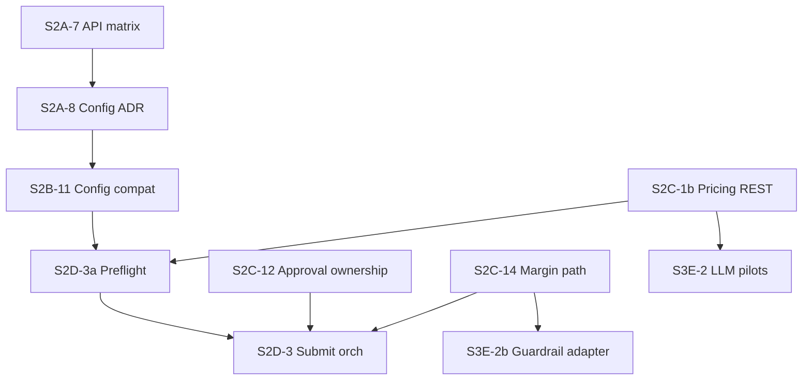

# Amendment PR Templates (Graphite)

Copy-paste PR descriptions for **post-review amendment** slices from [GRAPHITE_CPQ_MICROSERVICE_BACKLOG.md](./GRAPHITE_CPQ_MICROSERVICE_BACKLOG.md) (Post-Review Amendment PR Specifications). Use with the Graphite team playbook: small reviewable PRs, stack position in the description, verification evidence before `gt submit`.

**Trunk:** `main` · **Worktree pattern:** one lane per stack (e.g. `stacks/s2a-contracts`, `stacks/s2c-pricing`).

**Insert mid-stack:** check out the direct parent branch, then `gt create --insert`.

---

## Merge gate coordination

Amendment and downstream PRs must respect **merge order** (parallel worktrees OK; merge sequentially):

| Must land first | Before |
|-----------------|--------|
| **S2A-7**, **S2A-8** | **S2B-11**, **S2E-2** (contract matrix) |
| **S2C-1b** | **S2D-3a**, **S3E-2** |
| **S2B-11** | **S2D-3a** |
| **S2C-12** | **S2D-3** |
| **S2C-14** | **S2D-3**, **S3E-2b** |
| **S2D-3a** | **S2D-3** |
| **S2D-2** | **S2E-4** |
| **S2E-4** | **S2F-4** |
| **S3E-1** | **S3E-2**, **S3E-2b** |

**Lane coordination agents (backlog):**

- **S2B + S2E:** `S2B-11` (product-service, configuration-engine, gateway-service).
- **S2C + S2D:** `S2C-1b`, `S2C-12`, `S2C-14`, `S2D-3a`, `S2D-3`.
- **S3E:** keep **S3E-2** (LLM pilots) and **S3E-2b** (deterministic guardrails) in **separate PRs**.



---

## S2A-7 — API contract registry

| Field | Value |
|-------|-------|
| **Backlog ID** | S2A-7 |
| **Suggested branch** | `docs/cpq-api-contract-matrix` |
| **Stack position** | **7/8** in Stack 2A (Shared Contracts) |
| **Stack dependency** | S2A-6 |
| **Blocks** | S2A-8, S2B-11, S2E-2 |

### `gt create` example

```bash
git checkout <parent-branch-s2a-6>
gt create docs/cpq-api-contract-matrix --insert -am "docs(cpq): publish API contract matrix and gateway stubs"
```

### PR description (copy-paste)

```markdown
## Stack position
**7/8** in Stack 2A — Shared Contracts and Published Language

## Dependencies
- **Requires merged:** S2A-6 (contract/serialization tests for published-language DTOs)
- **Blocks:** S2A-8, S2B-11, S2E-2

## Summary
- Publish `docs/backlog/CPQ_API_CONTRACT_MATRIX.md` with agent-critical routes (`/api/v1/configuration/*`, `/api/v1/pricing/*`, `/api/v1/rules/*`, `/api/v1/quotes/*`), owning service, and stability tier.
- Add gateway route stubs that preserve legacy/agent-stable paths without domain logic in the gateway.
- Align matrix entries with `validation-rules`, `compatibility-rules`, and `minimum-margin-enforcement` agent PRDs.

## Acceptance criteria
- [ ] `CPQ_API_CONTRACT_MATRIX.md` lists every agent-critical route from `validation-rules`, `compatibility-rules`, and `minimum-margin-enforcement` with owning service.
- [ ] Gateway exposes stable paths without domain logic.
- [ ] Contract matrix referenced in this PR description.

## Verification
```bash
cd backend
mvn -pl services/gateway-service -am test
```
- [ ] Matrix doc reviewed against agent PRDs (no missing routes).

## Reference docs
- `cpq-pricing-prd.md`
- `agents/validation-rules.md`
- `agents/compatibility-rules.md`
- `agents/minimum-margin-enforcement.md`
- `docs/GRAPHITE_STACKED_PRS.md`
```

---

## S2A-8 — Configuration API ADR

| Field | Value |
|-------|-------|
| **Backlog ID** | S2A-8 |
| **Suggested branch** | `docs/configuration-api-adr` |
| **Stack position** | **8/8** in Stack 2A |
| **Stack dependency** | S2A-7 |
| **Blocks** | S2B-11 |

### `gt create` example

```bash
git checkout <parent-branch-s2a-7>
gt create docs/configuration-api-adr -am "docs(cpq): ADR for configuration rule CRUD vs session validate"
```

### PR description (copy-paste)

```markdown
## Stack position
**8/8** in Stack 2A — Shared Contracts and Published Language (top of 2A lane)

## Dependencies
- **Requires merged:** S2A-7 (API contract matrix)
- **Blocks:** S2B-11

## Summary
- Record configuration API reconciliation ADR: rule CRUD on `product-service` (`ConfigurationRuleController`); session validation on `configuration-engine` (`/api/v1/configurations/{id}/validate`).
- Explicit decision: `POST /api/v1/configuration/validate` remains the **agent contract path** (gateway-backed).
- No breaking removal of product-service routes without a gateway shim.

## Acceptance criteria
- [ ] ADR names canonical owner for rule CRUD vs session validate vs agent validate.
- [ ] Explicit decision: `POST /api/v1/configuration/validate` remains the agent contract path.
- [ ] No breaking removal of product-service routes without gateway shim.

## Verification
- [ ] ADR review complete (docs-only PR; no compile changes required in this PR).

## Reference docs
- `backend/services/configuration-engine/DDD_SPEC.md`
- `backend/services/product-service/DDD_SPEC.md`
- `agents/compatibility-rules.md`
- `docs/backlog/CPQ_API_CONTRACT_MATRIX.md` (from S2A-7)
```

---

## S2B-11 — Configuration compatibility layer

| Field | Value |
|-------|-------|
| **Backlog ID** | S2B-11 |
| **Suggested branch** | `cpq/configuration-api-compat` |
| **Stack position** | **11/11** in Stack 2B (Product and Configuration) |
| **Stack dependency** | S2A-8, S2B-8, S2E-1 |
| **Blocks** | S2D-3a |

### `gt create` example

```bash
git checkout <parent-branch-s2b-10>
gt create cpq/configuration-api-compat -am "feat(cpq): configuration API compatibility layer per S2A-8 ADR"
```

### PR description (copy-paste)

```markdown
## Stack position
**11/11** in Stack 2B — Product and Configuration Boundary

## Dependencies
- **Requires merged:** S2A-8 (configuration ADR), S2B-8 (compatibility rule validation), S2E-1 (gateway routes baseline)
- **Blocks:** S2D-3a (validation-rules preflight)

## Summary
- Harden `POST/GET/DELETE /api/v1/configuration/rules*` on product-service per ADR.
- Implement gateway-backed `POST /api/v1/configuration/validate` delegating to configuration-engine session validation or a stateless compatibility evaluator.
- Add contract tests proving agent paths remain stable per S2A-7 matrix.

## Acceptance criteria
- [ ] `POST /api/v1/configuration/validate` returns structured pass/fail compatible with agent PRDs.
- [ ] `POST/GET/DELETE /api/v1/configuration/rules*` pass contract tests.
- [ ] Gateway routes match S2A-7 matrix.
- [ ] Session path `/api/v1/configurations/{id}/validate` remains available.

## Verification
```bash
cd backend
mvn -pl services/product-service,services/configuration-engine,services/gateway-service -am test
```

## Reference docs
- `agents/compatibility-rules.md`
- `agents/validation-rules.md`
- `cpq-pricing-prd.md`
- `docs/backlog/CPQ_API_CONTRACT_MATRIX.md`
```

---

## S2C-1b — Pricing execute + DRL validate REST

| Field | Value |
|-------|-------|
| **Backlog ID** | S2C-1b |
| **Suggested branch** | `pricing/execute-simulate-validate-rest` |
| **Stack position** | **2/15** in Stack 2C (insert after S2C-1) |
| **Stack dependency** | S2C-1, S2A-4 |
| **Blocks** | S2C-2, S2C-10, S2D-3a, S3E-2 |

### `gt create` example

```bash
git checkout <parent-branch-s2c-1>
gt create pricing/execute-simulate-validate-rest --insert -am "feat(pricing): expose execute, simulate, and rules validate REST"
```

### PR description (copy-paste)

```markdown
## Stack position
**2/15** in Stack 2C — Pricing, Pricebook, and Approval (**inserted** after S2C-1)

## Dependencies
- **Requires merged:** S2C-1 (PricingSnapshot / waterfall model), S2A-4 (batch DRL compile tests)
- **Blocks:** S2C-2, S2C-10, S2D-3a, S3E-2

## Summary
- Expose `POST /api/v1/pricing/execute` (waterfall + audit + `PriceCalculated`) and `POST /api/v1/pricing/simulate` (no persistence).
- Wire `POST /api/v1/rules/{id}/validate` via `RuleController` → `RuleService.validate` → rules-engine compile check.
- Add golden fixtures aligned with S2A-4 DRL tests; green `PricingServiceClient` integration test.

## Acceptance criteria
- [ ] `POST /api/v1/pricing/execute` returns deterministic waterfall + audit; golden tests match S2A-4 fixtures.
- [ ] `POST /api/v1/pricing/simulate` persists nothing.
- [ ] `POST /api/v1/rules/{id}/validate` delegates to rules-engine compile check.
- [ ] `PricingServiceClient` integration test green.

## Verification
```bash
cd backend
mvn -pl services/pricing-service -am verify
```

## Reference docs
- `cpq-pricing-prd.md`
- `agents/minimum-margin-enforcement.md`
- `agents/volume-discount.md`
- `agents/validation-rules.md`
- `docs/phase0/phase0-drools-compatibility.md`
```

---

## S2C-12 — Approval ownership reconciliation

| Field | Value |
|-------|-------|
| **Backlog ID** | S2C-12 |
| **Suggested branch** | `approval/ownership-reconciliation` |
| **Stack position** | **13/15** in Stack 2C |
| **Stack dependency** | S2C-9 |
| **Blocks** | S2C-13, S2D-3 |

### `gt create` example

```bash
git checkout <parent-branch-s2c-11>
gt create approval/ownership-reconciliation -am "refactor(approval): reconcile pricing events vs approval-routing ownership"
```

### PR description (copy-paste)

```markdown
## Stack position
**13/15** in Stack 2C — Pricing, Pricebook, and Approval

## Dependencies
- **Requires merged:** S2C-9 (`DiscountApprovalRequired` / `MarginThresholdViolated` from pricing)
- **Blocks:** S2C-13, S2D-3 (quote submit orchestration)

## Summary
- **Pricing** publishes threshold events only; no approval policy in pricing-service.
- **approval-routing** owns `/api/v1/approvals/*` workflow state and policy evaluation.
- **quote-service** BFF delegates (`POST /api/v1/quotes/{quoteId}/approvals`, `GET /api/v1/quotes/approvals/pending`); reduce duplicate in-process `ApprovalService` logic to orchestration; persist policy-evaluation snapshots.

## Acceptance criteria
- [ ] Pricing emits events only; no approval policy in pricing-service.
- [ ] approval-routing owns `/api/v1/approvals/*` workflow state.
- [ ] quote-service BFF delegates; duplicate `ApprovalService` decision logic removed or reduced to orchestration.
- [ ] Agent paths `POST /api/v1/quotes/{quoteId}/approvals` and `GET /api/v1/quotes/approvals/pending` still work.

## Verification
```bash
cd backend
mvn -pl services/pricing-service,services/approval-routing,services/quote-service -am test
```
- [ ] Cross-service test: pricing event → approval-routing workflow → quote BFF list pending.

## Reference docs
- `backend/services/approval-routing/DDD_SPEC.md`
- `backend/services/quote-service/DDD_SPEC.md`
- `agents/multilevel-approval-routing.md`
- `agents/minimum-margin-enforcement.md`
```

---

## S2C-14 — Deterministic margin path

| Field | Value |
|-------|-------|
| **Backlog ID** | S2C-14 |
| **Suggested branch** | `pricing/margin-enforcement-integration` |
| **Stack position** | **15/15** in Stack 2C (top of 2C lane) |
| **Stack dependency** | S2C-1b, S2C-9, S2C-13 |
| **Blocks** | S2D-3, S3E-2b |

### `gt create` example

```bash
git checkout <parent-branch-s2c-13>
gt create pricing/margin-enforcement-integration -am "test(pricing): deterministic margin path to approval tiers"
```

### PR description (copy-paste)

```markdown
## Stack position
**15/15** in Stack 2C — Pricing, Pricebook, and Approval (top of 2C lane)

## Dependencies
- **Requires merged:** S2C-1b (pricing/execute), S2C-9 (threshold events), S2C-13 (approval policy / tiers)
- **Blocks:** S2D-3, S3E-2b

## Summary
- Integration tests: `POST /api/v1/pricing/execute` with `approval-margin-exception.drl` emits `MarginThresholdViolated`.
- approval-routing creates DEAL_DESK / CFO / below-cost tier workflows without LLM or ai-service on the path.
- Validates salience 930 behavior per Phase 0 DRL catalog.

## Acceptance criteria
- [ ] Margin threshold breach produces `MarginThresholdViolated` event.
- [ ] approval-routing assigns DEAL_DESK / CFO / below-cost tiers without LLM.
- [ ] No AI-service code on the execution path.
- [ ] Matches `approval-margin-exception.drl` salience 930 behavior.

## Verification
```bash
cd backend
mvn -pl services/pricing-service,services/approval-routing -am test
```
- [ ] Scenario test from `agents/minimum-margin-enforcement.md`.

## Reference docs
- `agents/minimum-margin-enforcement.md`
- `docs/phase0/phase0-drools-compatibility.md`
```

---

## S2D-3a — Validation-rules preflight

| Field | Value |
|-------|-------|
| **Backlog ID** | S2D-3a |
| **Suggested branch** | `quote/validation-preflight` |
| **Stack position** | **3/14** in Stack 2D (insert after S2D-2) |
| **Stack dependency** | S2B-11, S2C-1b, S2D-2 |
| **Blocks** | S2D-3 |

### `gt create` example

```bash
git checkout <parent-branch-s2d-2>
gt create quote/validation-preflight --insert -am "feat(quote): FULL_PREFLIGHT validation-rules orchestrator"
```

### PR description (copy-paste)

```markdown
## Stack position
**3/14** in Stack 2D — Quote, Documents, Contract, and CRM (**inserted** after S2D-2)

## Dependencies
- **Requires merged:** S2B-11 (configuration validate compat), S2C-1b (pricing/execute + clients), S2D-2 (line snapshots)
- **Blocks:** S2D-3 (quote submission orchestration)

## Summary
- Implement `FULL_PREFLIGHT` orchestrator: product status, configuration validate via `ProductServiceClient`, quote completeness, cross-service referential integrity, DRL validate handoff.
- Classify ERROR vs WARNING; no AI overrides of deterministic failures.
- No inline compatibility logic in quote-service.

## Acceptance criteria
- [ ] `FULL_PREFLIGHT` runs product status, configuration validate, quote completeness, and cross-service integrity checks.
- [ ] ERROR blocks; WARNING override-eligible.
- [ ] Uses `ProductServiceClient` + `PricingServiceClient`; no inline compatibility logic in quote-service.

## Verification
```bash
cd backend
mvn -pl services/quote-service -am test
```
- [ ] Tests use mocked downstream clients for configuration and pricing paths.

## Reference docs
- `agents/validation-rules.md`
- `agents/compatibility-rules.md`
- `cpq-pricing-prd.md`
```

---

## S3E-2 — LLM orchestration pilots (revised)

| Field | Value |
|-------|-------|
| **Backlog ID** | S3E-2 (revised) |
| **Suggested branch** | `ai/llm-pilot-segment-volume` |
| **Stack position** | **2/5** in Stack 3E (Open CRM AI Service Pilot) |
| **Stack dependency** | S3E-1, S2C-1b |
| **Blocks** | S3E-3 |
| **Do not combine with** | S3E-2b |

### `gt create` example

```bash
git checkout <parent-branch-s3e-1>
gt create ai/llm-pilot-segment-volume -am "feat(ai): LLM pilots for segment and volume discount agents only"
```

### PR description (copy-paste)

```markdown
## Stack position
**2/5** in Stack 3E — Open CRM AI Service Pilot

## Dependencies
- **Requires merged:** S3E-1 (thin LLM adapter seam), S2C-1b (`POST /api/v1/pricing/execute`)
- **Blocks:** S3E-3
- **Excludes:** `minimum-margin-enforcement` (deterministic — see S3E-2b / S2C-14)

## Summary
- Convert **orchestration-only** pilots for `customer-segment-discount` and `volume-discount` from simulated output to model-backed explanations and tool routing.
- Every numeric price outcome from `PricingServiceClient` → `POST /api/v1/pricing/execute`; never from LLM output.
- LLM output cannot change price or approval tier.

## Acceptance criteria
- [ ] Only `customer-segment-discount` and `volume-discount` use LLM.
- [ ] All numeric outcomes sourced from `pricing/execute` responses.
- [ ] LLM output cannot change price or approval tier.

## Verification
```bash
cd backend
mvn -pl services/ai-service -am test
```
- [ ] Tests assert pricing client invoked; no direct price mutation in agent code.

## Reference docs
- `docs/phase0/phase0-ai-stack-decision.md`
- `agents/customer-segment-discount.md`
- `agents/volume-discount.md`
- `backend/services/ai-service/DDD_SPEC.md`
```

---

## S3E-2b — Deterministic guardrail adapters

| Field | Value |
|-------|-------|
| **Backlog ID** | S3E-2b |
| **Suggested branch** | `ai/guardrail-margin-adapter` |
| **Stack position** | **3/5** in Stack 3E (after S3E-2) |
| **Stack dependency** | S2C-14, S3E-1 |
| **Blocks** | S3E-3 |
| **Do not combine with** | S3E-2 |

### `gt create` example

```bash
git checkout <parent-branch-s3e-2>
gt create ai/guardrail-margin-adapter -am "feat(ai): deterministic minimum-margin-enforcement adapter"
```

### PR description (copy-paste)

```markdown
## Stack position
**3/5** in Stack 3E — Open CRM AI Service Pilot

## Dependencies
- **Requires merged:** S2C-14 (deterministic margin path), S3E-1 (adapter seam)
- **Blocks:** S3E-3
- **Separate PR from:** S3E-2 (LLM pilots)

## Summary
- Deterministic adapter for `minimum-margin-enforcement`: `POST /api/v1/pricing/execute`, interpret margin result, delegate approval creation to quote BFF → approval-routing; audit only.
- Zero LLM calls on the adapter path.

## Acceptance criteria
- [ ] `minimum-margin-enforcement` adapter uses pricing/execute + approval BFF only.
- [ ] Zero LLM calls in adapter path.
- [ ] Audit log entries written.

## Verification
```bash
cd backend
mvn -pl services/ai-service -am test
```
- [ ] Unit test with LLM bean absent/disabled on guardrail path.

## Reference docs
- `agents/minimum-margin-enforcement.md`
- `backend/services/ai-service/DDD_SPEC.md`
```

---

## Quick reference — amendment PR index

| ID | Branch slug | Stack | Insert? |
|----|-------------|-------|---------|
| S2A-7 | `docs/cpq-api-contract-matrix` | 2A 7/8 | No |
| S2A-8 | `docs/configuration-api-adr` | 2A 8/8 | No |
| S2B-11 | `cpq/configuration-api-compat` | 2B 11/11 | No |
| S2C-1b | `pricing/execute-simulate-validate-rest` | 2C 2/15 | **Yes** (after S2C-1) |
| S2C-12 | `approval/ownership-reconciliation` | 2C 13/15 | No |
| S2C-14 | `pricing/margin-enforcement-integration` | 2C 15/15 | No |
| S2D-3a | `quote/validation-preflight` | 2D 3/14 | **Yes** (after S2D-2) |
| S3E-2 | `ai/llm-pilot-segment-volume` | 3E 2/5 | No |
| S3E-2b | `ai/guardrail-margin-adapter` | 3E 3/5 | No |

**Ship:** lane-local green verify → `gt submit --stack` (see `graphite-submit-sync` skill and `docs/GRAPHITE_STACKED_PRS.md`).
