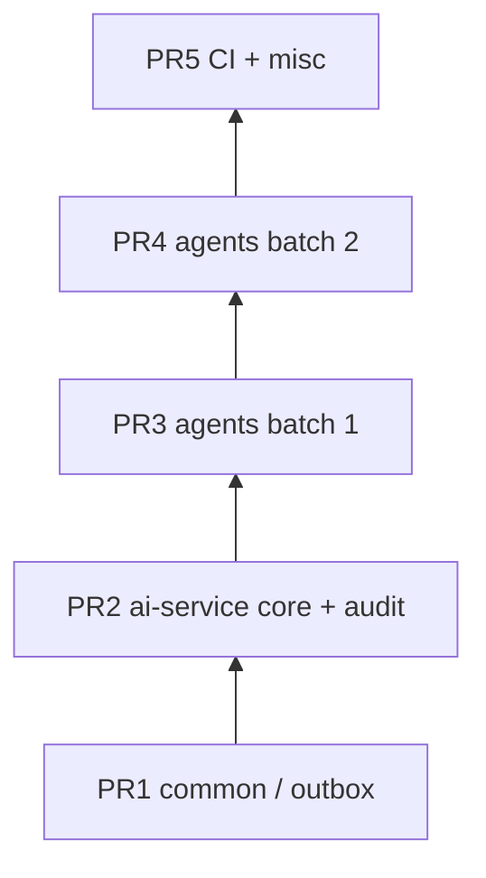

# Architecture review — implementation backlog & Graphite stacks

This backlog turns **documented architecture decisions** into shippable work, ordered for [Graphite](https://graphite.dev) **stacks** (merge bottom-up). Primary inputs:

| Document | Role |
|----------|------|
| [phase0-ai-stack-decision.md](../phase0/phase0-ai-stack-decision.md) | Path A (now) vs Path B (later); router/`CpqAgent` seam |
| [ADR-002](../adr/ADR-002-primary-llm-glm-5.md) / [ADR-001](../adr/ADR-001-primary-llm-claude-sonnet-4-6.md) | Primary LLM choice, compliance/fallback follow-ups |
| [GRAPHITE_STACKED_PRS.md](../GRAPHITE_STACKED_PRS.md) | Stacking rules, CI, `gt` workflow |
| `MODERNIZATION_PLAN.md` (repo root, if present) | Broader upgrade themes (e.g. Spring AI 1.x) |

**Rule:** One **epic** → ideally **one Graphite stack** (avoid one endless chain across unrelated domains). Within an epic, order PRs by **compile-time dependency** (shared libs → service core → leaf packages → CI/docs).

---

## Epic map (backlog)

| ID | Epic | Outcome | Suggested stack |
|----|------|---------|-----------------|
| E1 | **Platform reliability — outbox & events** | Safer cross-service publication from shared library | Stack A (bottom) |
| E2 | **AI service — audit & agent core** | Consistent audit logging, `AbstractCpqAgent` / config alignment | Stack A |
| E3 | **AI agents — domain batches** | Agents + tests per package (`pricing`, `governance`, …) without breaking `mvn verify` | Stack A (multiple PRs) |
| E4 | **CI & repo hygiene** | Green pipelines for stacked refs; `.gitignore` / workflow tweaks | Stack A (top) or tiny parallel stack |
| E5 | **Path A — LLM integration (pilot)** | Real `ChatClient` calls; pilot agents per [phase0](../phase0/phase0-ai-stack-decision.md) success criteria | **Stack B** (after A merges) |
| E6 | **Path B — Spring AI 1.x + `ChatModel`** | Upgrade + adapter behind `CpqAgent`; Azure config reconciled | **Stack C** (separate; high risk) |
| E7 | **ADR compliance** | Data residency / DPA, ADR-003 fallback provider | **Stack D** or tracked issues (often non-code) |

---

## Stack A — Current “architecture hardening” batch (dependency order)

Use when landing the large `ai-service` + `common` touch set. **Bottom** must compile alone; each PR above it adds only what depends on the previous head.



| Order | PR focus | Typical paths | Done when |
|-------|-----------|---------------|-----------|
| 1 | Shared library / outbox | `backend/libs/common/**` | `mvn -pl libs/common` (or parent `-am`) green |
| 2 | AI core + audit | `AbstractCpqAgent`, `AgentAuditLogger`, `AgentConfiguration`, `application.yml`, `ai-service/pom.xml`, core tests | `mvn -pl services/ai-service -am verify` green |
| 3–N | Agent domains | `backend/services/ai-service/.../agent/<domain>/**` + matching `src/test/**` | Same; split so no middle PR breaks compile |
| last | Cross-cutting | `.github/workflows/ci.yml`, `docs/**`, `.gitignore` | Full CI green on each PR ref |

**Suggested branch names:** `platform/outbox-relay`, `ai/audit-core`, `ai/agents-pricing`, `ai/agents-governance`, … `chore/ci-graphite-followup`.

**Graphite CLI sketch** (from clean `main`; adjust names):

```bash
git checkout main && git pull origin main && gt sync

gt create platform/outbox-relay -m "fix(common): outbox relay publisher hardening"
# commit only E1 files →

gt create ai/audit-core -m "feat(ai-service): agent audit logger and abstract agent wiring"
# commit E2 →

gt create ai/agents-pricing -m "refactor(ai): pricing agents + tests"
# commit one domain batch →

# ... repeat gt create for each domain batch ...

gt create chore/ci-backlog -m "chore(ci): workflow and ignore updates for stacked PRs"

gt submit --no-interactive
```

---

## Stack B — Path A pilot (after Stack A)

Goal: meet [phase0](../phase0/phase0-ai-stack-decision.md) **Phase 4A** evidence: list agents from registry; `/invoke` and `/stream` return real model-backed output for a **pilot** set.

| Order | PR | Scope |
|-------|-----|--------|
| 1 | Internal LLM helper | Thin adapter around existing `ChatClient` bean; shared error/retry policy stub if needed |
| 2 | Pilot agents | Wire 2–3 agents end-to-end using `agents/*.md` specs |
| 3 | Tests + config | Integration tests with testcontainers or mocks; `application.yml` profile for CI |

---

## Stack C — Path B (defer until Stack B stable)

Spring AI `1.0.0+`, `ChatModel` migration, Azure-specific beans — **do not** mix with Stack A agent refactors.

---

## Stack D — ADR / compliance

Track as issues or a tiny stack:

- [ ] ADR-002 checklist: compliance / data residency before production
- [ ] ADR-003: fallback LLM provider decision + implementation

---

## Session checklist (author)

- [ ] Confirm trunk is `main` (`gt sync`).
- [ ] Each PR is **reviewer-sized** (team norm; ~400 lines or domain-scoped).
- [ ] PR description states **stack position** (e.g. “2/5 in Stack A — base: `platform/outbox-relay`”).
- [ ] After each bottom merge: `git checkout main && git pull && gt sync` before continuing the chain.

---

## Related

- [Graphite stacked PRs guide](../GRAPHITE_STACKED_PRS.md)
