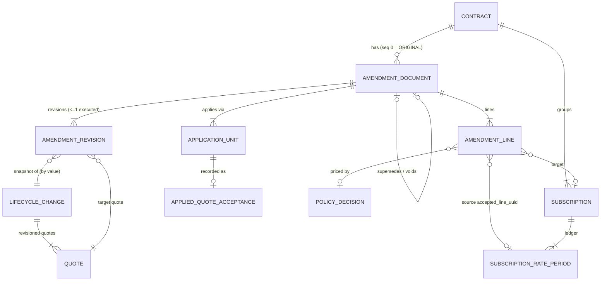
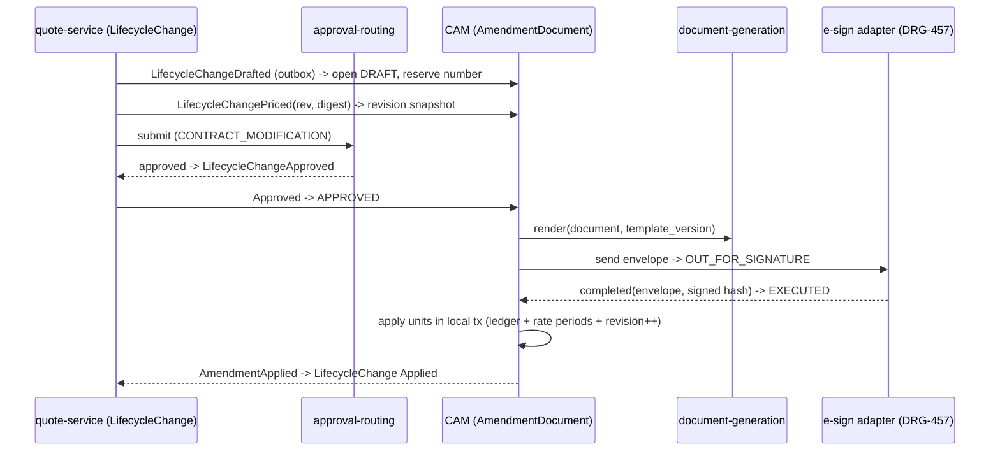
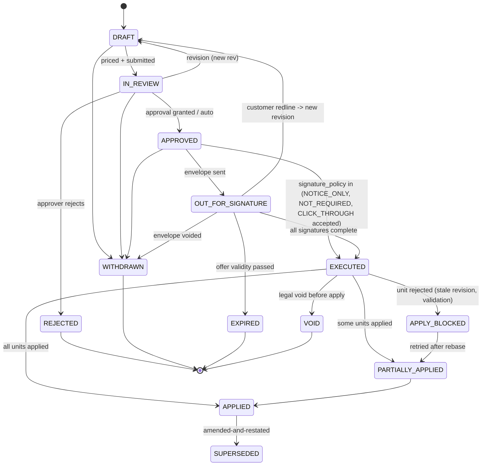

# Amendment document entity: design spike

*open-crm-cpq, design only. No code changes and no PRs. Date: 16 Oct 2026.*

**Inputs**
- Repo facts: `drgaciw/open-crm-cpq` main, read through the GitHub connector.
- Market research: `/workspace/cpq-renewals-amendments-research.md`. Source IDs `[Sn]` refer to its section 8.
- Call context: the proposed LifecycleChange root, a company mix of 60% on-prem and 40% SaaS, and audit elevated to first class.

**Conventions**
- Statements marked **[INFERENCE]** are design proposals or my own analysis.
- Everything else cites a repo path or a research source.
- Facts that came from the delegation brief and were not re-read in code are marked *(brief)*.

---

## Decisions needed (top)

1. **Placement.** Where should AmendmentDocument live?
   - Recommended: **contract-asset-management (CAM)**, inside a minimal Contract aggregate.
   - Alternatives: quote-service, or a new contract-document service. See section 6.1.
2. **Apply trigger.** Should the subscription ledger apply on **Executed** (signed) or on **Accepted** (quote accepted, as today)?
   - Recommended: Executed, with a per-intent signature policy so that notice-only true-ups and click-through SaaS changes can auto-execute.
3. **Contract header now or later.** Should we add a thin `contracts` header in CAM now, or wait for BC-07-01 (DRG-458)?
   - Recommended: a thin header now, keyed so that DRG-458 can enrich it.
4. **Numbering.** Use a per-contract sequence (`{contract_number}-A{nnn}`) that stays stable across revisions until execution, with no gaps among executed amendments.
5. **Partial application.** Should one document be allowed to apply in several units, with a PARTIALLY_APPLIED state?
   - Recommended: yes, with atomic units and no silent rollback.
6. **Revision model.** A new LifecycleChange or quote revision creates a new document *revision* under the same amendment number. Only one revision can be executed.
7. **Backfill scope.** Options:
   - Synthesize an ORIGINAL document per subscription plus BACKFILLED documents for past non-NEW acceptances.
   - Start fresh at cutover.
   - Recommended: synthesize, flagged as legacy evidence.
8. **Retention.** Legal must set the retention window and legal-hold rules for executed amendments. Link to BC-20-05 (DRG-313).

---

## 0. Context and current state (facts)

**The continuation is one typed path in quote-service.**
- `QuoteContinuationRequest.Operation` = {AMENDMENT, EXPANSION, RENEWAL, EXTENSION}.
- Each request carries exactly one `sourceSubscriptionLineUuid`, a quantity, `observedRevision`, `targetSubscriptionNumber`, an optional effective date, term months and uplift percent.
- Source: `backend/services/quote-service/src/main/java/com/opencrm/quote/quote/QuoteContinuationRequest.java`.

**`QuoteContinuationPolicy.plan` takes rates only from the accepted subscription schedule.** It requires all of the following:
- `observedRevision == commercialRevision`
- an ACTIVE target
- a source line with `ACCEPTED_PRICED` provenance

It then prices as follows:
- **Renewal / extension:** uses the exit rate. Renewal applies uplift of 0 to 100%; extension allows no uplift.
- **Amendment / expansion:** keeps the term and the accepted unit rates, and prorates a stub billing month by day count.

Source: `.../quote/QuoteContinuationPolicy.java`.

**Quote columns.** These were added additively: `target_subscription_number`, `observed_revision`, `subscription_effective_date`, `continuation_request_json`, `quote_line_items.source_subscription_line_uuid`, `hybrid_migration_json`, `initial_proration_json`.
- Source: `backend/services/quote-service/src/main/resources/db/migration/V1_10__quote_subscription_continuation.sql`.
- The original operation survives only in `continuation_request_json`; `deal_type` is NEW | AMENDMENT | RENEWAL | EXPANSION *(brief; also DRG-546)*.

**Quote statuses.** `QuoteStatus` = DRAFT, IN_REVIEW, PENDING_APPROVAL, APPROVED, SENT, ACCEPTED, EXPIRED, CANCELLED, REJECTED (`.../quote/QuoteStatus.java`).

**Apply happens in CAM on QuoteAccepted.** `AcceptedQuoteSubscriptionService.apply` (`backend/services/contract-asset-management/src/main/java/com/opencrm/contract/service/AcceptedQuoteSubscriptionService.java`):
- Accepts NEW, AMENDMENT, EXPANSION and RENEWAL.
- Computes a SHA-256 digest of the canonical event, excluding `acceptedAt`, `correlation`, `eventType` and `eventVersion`.
- Rejects reuse of a quote id when the commercial facts have changed.
- Rejects a stale `observedRevision`.
- For AMENDMENT, requires unique explicit source-line ids. It then end-dates the replaced rate periods (`effective_end_date = effective - 1`, and `retired` if they had not started yet).
- Increments `commercial_revision` and queues ERP sync.
- Writes `applied_quote_acceptances`.

**CAM schema** (`V1_6__subscription_rate_schedule.sql`):
- `subscription_rate_periods` carries `accepted_line_uuid`, `source_line_uuid`, `accepted_quote_id`, `effective_end_date`, `retired`, `provenance`, `explanation_codes` and `migration_credit`.
- `applied_quote_acceptances` has `accepted_quote_id UNIQUE`, **one** `subscription_id`, `operation` and `commercial_digest`.
- Legacy rows were backfilled with provenance `LEGACY_AGGREGATE`, and backfill "never emit[s] retroactive RampApplied".

**There is no contract entity.** CAM has `subscriptions` (status PENDING / ACTIVE / SUSPENDED / CANCELLED / EXPIRED) and outbox tables only (`V1_1__create_contract_tables.sql`). There is also no amendment-number entity *(brief; DRG-535)*.

**Adjacent services that already exist:**
- **document-generation** (`document_generation_jobs`): `document_type` ∈ {QUOTE_PDF, CONTRACT_PDF, ORDER_FORM, INVOICE}, an idempotency key, and a QuoteAccepted consumer. There is no AMENDMENT type (`backend/services/document-generation/.../V1_1__create_document_tables.sql`, `.../event/QuoteAcceptedEventConsumer.java`).
- **approval-routing:** `ApprovalType` includes `CONTRACT_MODIFICATION` (`backend/services/approval-routing/.../domain/ApprovalType.java`).
- **pricing-service:** has an immutable `PricingAuditLog` (`input_snapshot`, `output_snapshot`, `waterfall_trace`, `rules_fired`, `rule_set_id`) in `backend/services/pricing-service/.../execution/PricingAuditLog.java`.
  - However, continuation pricing runs in quote-service and never goes through it.
  - `renewal-uplift.drl` and `amendment-proration.drl` exist under `backend/services/pricing-service/src/main/resources/rules/` but do not run on calculate, and the proration formulas disagree *(brief; DRG-541, DRG-542)*.
- **product-service, pricebook-service and configuration-engine** exist as services but sit outside the continuation path *(brief; DRG-539)*.

**Market context.**
- Platforms model an amendment as a **quote type or order**: SBQQ `__Type__c` = Amendment with an `AmendedContract` lookup [S11]; DealHub `orderType` [S18]; Zuora quote Subscription_Type plus `zqu__QuoteAmendment__c` [S38]; Oracle Modify [S40].
- Revision numbering appears only in QuoteWerks [S34].
- **[INFERENCE]** None of the researched vendors documents a separately numbered, legally executed *amendment document* with its own lifecycle. This supports the call's "market gap" observation and is the opportunity here.

---

## 1. Entity shape and fields

**[INFERENCE]** The LifecycleChange is the *commercial intent*: intent, change lines, policies and prices (research 7.2). The **AmendmentDocument** is the *legal and evidentiary wrapper* around one executed version of that intent. It adds what the LifecycleChange payload does not carry.

**AmendmentDocument (header)**

| Group | Fields | Notes |
|---|---|---|
| Identity | `id` (uuid), `amendment_number`, `amendment_seq`, `document_kind` {ORIGINAL, AMENDMENT, RENEWAL, AMENDED_AND_RESTATED, TRUE_UP_NOTICE, TERMINATION, RESTRUCTURE}, `external_reference` (customer PO / legal ref), `tenant_id` | Number = `{contract_number}-A{seq:03}`. Unique (`contract_id`, `amendment_seq`). Kind derives from intent but is overridable. |
| Parties | `customer_account_id` (today `subscriptions.customer_id`), `customer_legal_entity`, `vendor_legal_entity`, `bill_to_ref`, `signatories[]` (name, role, email, side), `reseller/partner_ref` | Parties are snapshotted at execution, not live-joined. |
| Scope links | `contract_id`, `lifecycle_change_id`, `lifecycle_change_revision`, `target_quote_id` (the continuation quote), `source_quote_ids[]` (derived from source lines' `accepted_quote_id`), `supersedes_document_id`, `superseded_by_document_id`, `voids_document_id`, `related_document_ids[]` | Section 2. |
| Commercial summary | `intent` (renew / amend / cancel / restructure / true-up / convert), `currency_code`, `tcv_delta`, `arr_delta`, `one_time_total`, `credit_total`, `co_term_date`, `pricing_policy_refs[]` | A digest-bound copy of the LifecycleChange's priced result. It is never recomputed. |
| Legal terms | `governing_agreement_ref` (MSA / EULA version), `clause_set_ref` + `clause_overrides[]`, `payment_terms`, `term_end_action`, `notice_period_days`, `liability/indemnity_ref`, `special_terms` (free text, redline history ref) | Clause content belongs to BC-06 templates (DRG-454); here we store references and version pins. |
| Dates | `action_date`, `contract_effective_date`, `service_activation_date`, `customer_acceptance_date`, `executed_at`, `applied_at`, `expires_at` (offer validity) | Separates action date from effective date [S15][S35] (DRG-553). |
| State | `status` (section 3), `signature_policy` {WET, E_SIGN, CLICK_THROUGH, NOTICE_ONLY, NOT_REQUIRED}, `approval_ref` (approval-routing request id), `signature_envelope_ref`, `version` (optimistic lock), `revision_no` | `version` follows the existing column pattern in CAM tables. |
| Evidence | `content_digest` (SHA-256 canonical), `rendition_digest` (PDF hash), `template_id`+`template_version`, `inputs_snapshot_ref`, `observed_commercial_revision`, `applied_commercial_revision` | Section 5. |
| Attachments | `attachments[]`: kind {RENDITION, SIGNED_COPY, CUSTOMER_PO, METER_REPORT, SUPPORTING}, `storage_uri`, `sha256`, `uploaded_by/at` | The signed PDF is immutable once Executed. |
| Housekeeping | `created_at/by`, `updated_at/by`, `is_deleted` (soft delete forbidden after Executed) | Same pattern as CAM migrations. |

**AmendmentDocumentLine**
- One row per LifecycleChange ChangeLine that appears in the document.
- Fields:
  - `line_no`
  - `change_line_ref`
  - `action_code` (research 7.2 ChangeLine)
  - `apply_target_type` {SUBSCRIPTION, ENTITLEMENT, ONE_TIME, NONE}
  - `target_subscription_id` / `target_entitlement_ref`
  - `source_accepted_line_uuid` (FK by value to `subscription_rate_periods.accepted_line_uuid`)
  - `result_accepted_line_uuid`
  - `product_external_id`
  - `metric`
  - `start_qty`, `delta_qty`, `end_qty`
  - `effective_from`, `effective_to`
  - `unit_price`, `net_amount`
  - `policy_decision_id`
  - `application_unit_id`

**AmendmentDocumentRevision**
- A snapshot of the header and lines for each LifecycleChange revision. It is immutable once Superseded or Executed.
- Fields: `revision_no`, `quote_version_ref`, `content_digest`, `status_at_close`.

---

## 2. Relationships

**Recommended ownership [INFERENCE]**
- quote-service owns **LifecycleChange** and quotes. This extends today's continuation (`QuoteContinuationService/Controller`).
- CAM owns **Contract**, **AmendmentDocument**, its lines and revisions, **ApplicationUnit**, and the existing subscription ledger.
- Cross-service links are by value: uuid plus digest. There are no cross-database foreign keys.

**Cardinalities and keys**

| Relationship | Cardinality | Owner | Key |
|---|---|---|---|
| Contract → AmendmentDocument | 1 : 0..* (ORIGINAL is seq 0) | CAM | `contract_id` + `amendment_seq` unique |
| AmendmentDocument → AmendmentDocumentRevision | 1 : 1..* (≤1 Executed) | CAM | (`document_id`, `revision_no`) |
| AmendmentDocumentRevision ↔ LifecycleChange revision | 1 : 1 | quote-service is the source, CAM holds a copy | (`lifecycle_change_id`, `revision`) + `content_digest` |
| LifecycleChange → AmendmentDocument | 1 : 0..1 (dry runs and abandoned drafts may have none) | — | `lifecycle_change_id` unique on the document |
| AmendmentDocumentRevision → target quote | 1 : 1 | quote-service | `target_quote_id` (= `applied_quote_acceptances.accepted_quote_id` after apply) |
| AmendmentDocument → source quotes | 0..* (derived) | CAM | `subscription_rate_periods.accepted_quote_id` of source lines |
| Contract → Subscription (ContractAsset) | 1 : 1..* | CAM | new `subscriptions.contract_id` (nullable during backfill) |
| AmendmentDocumentLine → Subscription / rate period | * : 0..1 / by value | CAM | `target_subscription_id`, `source_accepted_line_uuid` |
| AmendmentDocument → ApplicationUnit | 1 : 1..* | CAM | (`document_id`, `unit_no`) |
| ApplicationUnit → applied_quote_acceptances | * : 0..1 | CAM | new nullable `application_unit_id` / `amendment_document_id` column, or a join table |
| AmendmentDocument → AmendmentDocument | supersedes / voids 0..1 | CAM | self-references |

**Why "by value".** The repo already applies by value: `accepted_line_uuid` strings, `accepted_quote_id`, and a digest match in `AcceptedQuoteSubscriptionService`. **[INFERENCE]** Keeping that pattern avoids distributed transactions.

---

## 3. Document lifecycle states and mapping

**States [INFERENCE]**
- **Main path:** DRAFT → IN_REVIEW → APPROVED → OUT_FOR_SIGNATURE → EXECUTED → APPLIED.
- **Side exits:** REJECTED, WITHDRAWN, EXPIRED, SUPERSEDED, VOID.
- **Apply sub-states:** PARTIALLY_APPLIED and APPLY_BLOCKED.

**Mapping table.** LifecycleChange states come from research 7.3. Quote statuses come from `QuoteStatus.java`.

| Document state | LifecycleChange state | Quote status today | Trigger (who / what) | Idempotency / guard |
|---|---|---|---|---|
| DRAFT | Draft → Projected/Priced | DRAFT | Seller or the renewal job creates a LifecycleChange; CAM consumes `LifecycleChangeDrafted` and reserves `amendment_seq` | Inbox dedup on event id (CAM has `processed_events_inbox`, V1_3); unique `lifecycle_change_id` |
| IN_REVIEW | InApproval | IN_REVIEW / PENDING_APPROVAL | Seller submits; quote-service routes to approval-routing with `CONTRACT_MODIFICATION` | Transition is accepted only from DRAFT with a matching `revision_no` and `content_digest` |
| APPROVED | Approved | APPROVED | approval-routing decision, or auto-approve below threshold | Approval ref is stored; a re-delivered approval for the same revision is a no-op |
| OUT_FOR_SIGNATURE | Presented | SENT | CAM asks document-generation to render and the e-sign adapter to send | Rendition idempotency key = `document_id:revision:template_version` (fits `document_generation_jobs.idempotency_key`) |
| EXECUTED | Accepted | ACCEPTED | e-sign completion webhook, uploaded wet-signed copy, or an auto-execute policy | Envelope id unique; the signed-copy hash is stored; double callbacks are a no-op |
| APPLIED / PARTIALLY_APPLIED | Ordered → Applied | ACCEPTED | CAM applies units in a local transaction (today's `AcceptedQuoteSubscriptionService` logic, per unit) | Key = (`document_id`, `unit_no`, `content_digest`). The existing `applied_quote_acceptances.accepted_quote_id` uniqueness and digest-equality checks are kept; `observedRevision == commercial_revision` is checked per target |
| APPLY_BLOCKED | (Ordered, failed) | ACCEPTED | A validation failure such as a stale revision, retired source line or coverage gap | No partial writes inside a unit; needs a rebase revision or a correcting amendment |
| REJECTED | Rejected | REJECTED | Approver or customer declines | Terminal |
| WITHDRAWN | (Rejected / cancelled) | CANCELLED | Seller withdraws; voids the envelope | Terminal; amendment number released only if it was never executed [INFERENCE] |
| EXPIRED | Expired | EXPIRED | Validity timer | Terminal |
| SUPERSEDED (revision) | Superseded (revision) | (quote re-versioned) | New revision of the same LifecycleChange [S34] | Old revision frozen with its digest |
| SUPERSEDED (document) | — | — | A later AMENDED_AND_RESTATED document executes | Applied facts are never rewritten; only links are added |
| VOID | (Reverted, pre-apply) | — | Legal voids an executed but unapplied document | After apply, use a reversing amendment or DealHub-style revert [S20] (DRG-551) |

**Key behaviour change [INFERENCE].** Today the ledger mutates on QuoteAccepted. In this design QuoteAccepted moves the document to **EXECUTED** only when `signature_policy` allows click-through or notice-only execution. Otherwise apply waits for EXECUTED. This mirrors Salesforce CPQ, where the contract changes only when the order is Contracted, not when the quote is accepted [S1]. It also mirrors DealHub, where orders are DRAFT until executed [S19].

---

## 4. Multi-line amendments and the 60/40 mix

**Today.** One recurring source line per continuation (`QuoteContinuationPolicy.source` requires exactly one match). AMENDMENT needs unique `sourceSubscriptionLineUuid` values in CAM. Multi-line support is DRG-536.

**The document is designed multi-line from the start [INFERENCE].** Each line declares an `apply_target_type`, and lines are grouped into **ApplicationUnits**. A unit is the largest set of lines that must change atomically: normally one target subscription or one entitlement.

| Scenario | Document lines | Pricing policy | Apply units | Signature |
|---|---|---|---|---|
| **Capacity true-up** (on-prem cores / PVU / TB) | TrueUp lines: `metric`, `entitled_qty`, `measured_peak` (MeterReading ref), `delta_qty = max(0, peak - entitled)`, back-dated `effective_from` | True-up at contracted rate (research 7.4 inference); the decision records the meter snapshot digest [S59][S64] | ENTITLEMENT unit (capacity raise) + ONE_TIME (true-up charge) | Often NOTICE_ONLY under the existing licence right [INFERENCE] |
| **Perpetual + maintenance** | Perpetual line `isPermanent`, never renewed; maintenance line Renew linked to the licence (`relatedPerpetualLineId`) [S53][S54] | Maintenance as % of licence net (research 7.4 inference) | Maintenance as SUBSCRIPTION or ENTITLEMENT unit; the perpetual line is NONE (referenced only) | E_SIGN or PO |
| **On-prem → SaaS restructure** | Terminate maintenance + Add SaaS subscription + migration credit, in **one** document [S18][S43] | Restructure default policy: credit policy plus the existing migration-credit rule (`rules/migration-credit.drl`) and `hybrid_migration_json` | Unit 1: create SaaS subscription. Unit 2: end-date maintenance at the end of the dual-entitlement window (DRG-341). Unit 3: entitlement revoke (fulfilment [S56]) | E_SIGN (legal change of licence model) |
| **Mixed lines in one document** | SaaS seat change + on-prem capacity raise + services fee | Per-line policy; each line has its own decision record | One unit per target, plus ONE_TIME lines that go to order/billing, not the ledger | Single signature for the whole document |

**Partial application rules [INFERENCE]**
1. **Execution is all-or-nothing.** The customer signs one document. There is no partial signature.
2. **Each unit is atomic.** One CAM transaction writes the rate periods, end-dates the replaced lines, increments `commercial_revision` and writes the ledger row, as today.
3. **Units apply in dependency order:** create before terminate. A restructure never removes the old entitlement before the new subscription exists, which preserves the dual-entitlement window.
4. **Future-dated lines are applied immediately** as future rate periods. The table already separates `start_date` from `applied` / `retired`. "Applied" means *recorded*, not *in effect*.
5. **A failed unit is never silently rolled back** if other units already committed. The document moves to APPLY_BLOCKED or PARTIALLY_APPLIED and raises a task. The fix is either a rebase (re-observe the revision and re-price, which creates a new revision and needs re-approval if the price changed) or a correcting amendment. History stays append-only [S1][S16][S35].
6. **TMF622 has a `partial` order state [S65]**, which is precedent for a first-class partial outcome.
7. **Per-target optimistic concurrency.** Each unit carries its own `observed_commercial_revision`. A multi-subscription document therefore cannot be blocked by an unrelated change elsewhere.

---

## 5. Auditability

Audit is first class, so the document must answer four questions: **what changed, why that price, who approved and signed, and what the system applied**.

**Decision trail: PolicyDecision, one per line**
- Fields:
  - `policy_id` + `policy_version`
  - `intent`
  - `mode` (e.g. Renewal Same / List / Uplift%, Amend RetainContracted, Proration Daily) [S6][S25][S44]
  - `inputs`: source rate period ids and their `net_unit_price`, `observed_commercial_revision`, uplift source (caller, account, contract, line), meter reading id, pricebook version, configuration hash
  - `outputs`: unit price, periods, proration snapshot
  - `rules_fired`
  - `explanation_codes`
  - `reason_text`
  - `decided_by` (system or user override)
  - `decision_digest`
- Override precedence follows "most specific wins" [S6] and is recorded explicitly.

**Inputs snapshot**
- Freeze the `SubscriptionScheduleView` that `QuoteContinuationPolicy.plan` read, at the observed revision.
- Freeze product, pricebook and configuration version pins.
- Store each by digest, with content in an evidence store.
- This is what makes BC-20-03 replay (DRG-311) possible for continuations.
- Today continuation pricing in quote-service writes **no** audit row. `PricingAuditLog` exists only in pricing-service.

**Versions and digests**
- `content_digest`: canonical JSON of header, lines and decisions. Reuse the same canonicalization approach as `AcceptedQuoteSubscriptionService.digest`, which drops volatile fields, so the CAM apply check and the document agree.
- `rendition_digest` (PDF), `template_version`, `signed_copy_sha256`, `envelope_id`.
- The `applied_commercial_revision` of each unit.

**Immutable event log**
- `amendment_document_events` is append-only and hash-chained: `prev_hash`, `event_hash`, actor, from/to state, payload digest, `occurred_at`.
- It is published through the existing outbox to the BC-20-01 audit trail service (DRG-309).
- Corrections are new events, never updates.

**Tie to existing structures**
- `applied_quote_acceptances` stays the idempotency ledger. Add a nullable `amendment_document_id` and `application_unit_no`, or a join table, so that one document can map to several acceptance rows across subscriptions.
- Today `accepted_quote_id` is UNIQUE and the row holds a single `subscription_id`. That cannot represent one quote applied to several subscriptions. This is a gap: RA-29.
- `subscription_rate_periods.provenance`: add a value such as `AMENDMENT_APPLIED` plus `amendment_document_line_id`. Keep `LEGACY_AGGREGATE` and `ACCEPTED_PRICED` semantics.

**Retention**
- Executed documents, signed copies, decisions and event logs follow BC-20-05 retention and legal hold (DRG-313).
- **[INFERENCE]** The window is likely contract end plus N years, set by legal. Soft delete is forbidden after EXECUTED.

**Evidence query.** BC-20-04 `GetEvidenceChain(quoteId)` (DRG-312) should accept `amendmentId` and report missing links explicitly.

---

## 6. Open questions, risks, placement, integration, migration, API

### 6.1 Where it lives

| Option | Pros | Cons |
|---|---|---|
| **A. contract-asset-management (recommended)** | Owns the subscription ledger, `commercial_revision` and `applied_quote_acceptances`, so EXECUTED → APPLIED is one local transaction with the strongest idempotency. Natural home for the Contract header and per-contract numbering. Matches the BC-07 epic (DRG-288: "from accepted quote to activated entitlements"; BC-07-01 DRG-458, BC-07-04 DRG-461). Keeps quote-service focused on authoring and pricing. | CAM grows: a new aggregate, e-sign callbacks and attachments. Draft state reaches CAM via events (eventual consistency in authoring UIs). CAM must consume LifecycleChange events it does not own. |
| B. quote-service | Closest to LifecycleChange, the quote revisions and the approvals already wired to quotes. Simple draft UX. | The legal record would live in the authoring service. "Applied" and contract numbering would be learned from CAM events. Contract-level views (all amendments for a contract) cross services. Repeats today's coupling where quote state implies contract state. |
| C. New contract-document service | Clean bounded context; independent scaling and retention. | Another service, saga and database. A third party in apply idempotency (risk of split brain between "executed" and "applied"). Overlaps document-generation and CAM. Highest delivery cost. |

**Recommendation [INFERENCE]: option A.**
- LifecycleChange stays in quote-service. AmendmentDocument plus a thin Contract header go into CAM.
- Rendering stays in document-generation (add an `AMENDMENT` document type).
- Approvals stay in approval-routing (`CONTRACT_MODIFICATION`).
- E-sign goes through the DRG-457 adapter.
- Revisit option C only if contract documents need independent retention or tenancy rules that CAM cannot meet.
- Follow-up ADR: RA-27.

### 6.2 Product, pricebook and configuration integration [INFERENCE]
- When pricing, the document **pins** `product_external_id`, the product relationship version (upgrade or metric-conversion map [S62]), the pricebook version (for List renewal mode [S6]) and the configuration hash (for reconfigure or convert).
- configuration-engine validates the *target* configuration for Convert, Restructure and Upgrade lines.
- product-service supplies allowed transitions, following Revenera, where upgrades and upsells require configured product relationships [S54].
- All of these are read at Priced and frozen; apply never re-reads them.
- Overlaps DRG-539 (RA-05); no new item.

### 6.3 Migration and backfill [INFERENCE]
1. Add `contracts` and `subscriptions.contract_id`, nullable. Create one Contract per existing subscription, or group by customer plus original quote. Grouping rules are an open question.
2. Synthesize an **ORIGINAL** document (seq 0) per subscription from `subscriptions.quote_id`.
3. Synthesize a **BACKFILLED** document per `applied_quote_acceptances` row whose `operation` is not NEW. Set status APPLIED, `signature_policy = NOT_REQUIRED`, and mark the evidence as `LEGACY` with no signed copy.
4. Link rate periods via `accepted_quote_id`. `LEGACY_AGGREGATE` periods get document lines with unknown unit price, without inventing data. This mirrors the V1_6 rule against inventing unit price or quantity.
5. Emit **no** retroactive events. This mirrors V1_6, which never emits retroactive RampApplied.
6. Handle in-flight continuation quotes at cutover:
   - SENT / APPROVED quotes get a document lazily.
   - ACCEPTED but unapplied events take the legacy path, behind a feature flag.
7. Tracked as RA-32.

### 6.4 Risks
- **Behaviour change:** gating apply on EXECUTED delays ledger updates and ERP sync (RA-28). Mitigate with per-intent signature policy and auto-execute for click-through.
- **Contract header timing:** if DRG-458 later defines Contract differently, the header must be migrated. Mitigate by keeping the header thin and aligned with the DRG-458 names.
- **Digest drift:** document and CAM canonicalization must stay identical. Use a shared library in `backend/libs/common` [INFERENCE].
- **Multi-subscription documents** break the one-row-per-quote assumption in `applied_quote_acceptances` (RA-29).
- **Proration disagreement** (DRG-542) and unexecuted Drools rules (DRG-541) mean the "policy fired" trail is thin until pricing is unified (RA-30).
- **Perpetual and capacity lines have no ledger target today** (DRG-556, DRG-557). Those units stay ENTITLEMENT-pending until an entitlement ledger exists (DRG-460, DRG-558).

### 6.5 Other open questions
- Should AMENDED_AND_RESTATED replace the contract's governing terms, or only add to them?
- Do resellers or partners sign?
- Does the amendment-number sequence reset per renewal term?
- Can one document target several contracts? Proposed: no; use a merge intent (DRG-554).
- Who may VOID an executed document?

### 6.6 API sketch (resource names only)
- **quote-service:** `lifecycle-changes`, `lifecycle-changes/{id}/revisions`, `lifecycle-changes/{id}/pricing-decisions`, `lifecycle-changes/{id}:submit`, `lifecycle-changes/{id}:withdraw`. The existing continuation endpoint (`QuoteContinuationController`) becomes a facade.
- **CAM:**
  - `contracts`, `contracts/{id}/amendments`
  - `amendments/{id}`, `amendments/{id}/revisions`, `amendments/{id}/lines`, `amendments/{id}/decisions`, `amendments/{id}/attachments`, `amendments/{id}/rendition`, `amendments/{id}/signature`, `amendments/{id}/application-units`, `amendments/{id}/events`
  - actions `:void` and `:rebase`
  - internal `:execute` (e-sign callback) and `:apply`
- **Events:** `AmendmentDrafted`, `AmendmentSubmitted`, `AmendmentApproved`, `AmendmentSentForSignature`, `AmendmentExecuted`, `AmendmentUnitApplied`, `AmendmentApplied`, `AmendmentApplyBlocked`, `AmendmentWithdrawn`, `AmendmentSuperseded`, `AmendmentVoided`.
- **QuoteAccepted:** the payload gains an `amendmentDocumentId` and per-line `applicationUnitNo` (`backend/libs/common/.../QuoteAcceptedEvent.java`).

---

## 7. Backlog mapping

**New items from this spike**

| ID | Title |
|---|---|
| RA-27 / DRG-561 | ADR: placement and ownership of the amendment document entity |
| RA-28 / DRG-562 | Gate subscription apply on executed amendment, not quote acceptance |
| RA-29 / DRG-563 | Apply ledger cannot record one amendment across multiple subscriptions |
| RA-30 / DRG-564 | Continuation pricing decisions are not audited (no policy trail or inputs snapshot) |
| RA-31 / DRG-565 | Partial application rules for mixed-line amendment documents |
| RA-32 / DRG-566 | Backfill amendment history for existing subscriptions |

**Already covered (linked, not duplicated)**

| Topic | Existing items |
|---|---|
| Entity and numbering | RA-01 / DRG-535 |
| Multi-line | RA-02 / DRG-536 |
| Intents | RA-14 / DRG-548 |
| Approvals and revisions | RA-26 / DRG-560 |
| Revert | RA-17 / DRG-551 |
| Action vs effective dates | RA-19 / DRG-553 |
| Perpetual + maintenance | RA-22 / DRG-556 |
| Capacity true-up | RA-23 / DRG-557 |
| Fulfilment | RA-24 / DRG-558 |
| Restructure | RA-25 / DRG-559 |
| Product / pricebook / configuration | RA-05 / DRG-539 |
| Contract generation | BC-07-01 / DRG-458 |
| Amendments and co-termination | BC-07-04 / DRG-461 |
| E-signature | BC-06-04 / DRG-457 |
| Templates and rendition | BC-06-01, BC-06-03 / DRG-454, DRG-456 |
| Audit trail | BC-20-01 / DRG-309 |
| Calculation trace | BC-20-03 / DRG-311 |
| Evidence chain | BC-20-04 / DRG-312 |
| Retention and legal hold | BC-20-05 / DRG-313 |

**Links to the new items**

| ID | Linear | Notion |
|---|---|---|
| RA-27 / DRG-561 | https://linear.app/drgamtd-workspace/issue/DRG-561 | https://app.notion.com/p/3fbf7cb4e4df8113b991c90860c085ad |
| RA-28 / DRG-562 | https://linear.app/drgamtd-workspace/issue/DRG-562 | https://app.notion.com/p/3fbf7cb4e4df81a890e4f6f496913809 |
| RA-29 / DRG-563 | https://linear.app/drgamtd-workspace/issue/DRG-563 | https://app.notion.com/p/3fbf7cb4e4df817fb73dfffbb02681fe |
| RA-30 / DRG-564 | https://linear.app/drgamtd-workspace/issue/DRG-564 | https://app.notion.com/p/3fbf7cb4e4df8160afadfa10cb5f8d18 |
| RA-31 / DRG-565 | https://linear.app/drgamtd-workspace/issue/DRG-565 | https://app.notion.com/p/3fbf7cb4e4df815580e1fbac607d006e |
| RA-32 / DRG-566 | https://linear.app/drgamtd-workspace/issue/DRG-566 | https://app.notion.com/p/3fbf7cb4e4df812aa54ee13081ec340f |

## Addendum 2026-10-16 (dev-readiness pass; nothing above changed)
Status of the eight decisions at the top: 1 placement is ADR-035 (Proposed, blocks dev); 2 apply trigger resolved (EXECUTED); 3 thin header default (OQ3); 4 numbering resolved; 5 partial application default in OQ5; 6 revision model default in OQ6; 7 backfill reduced to header only for the first slice (OQ7, history stays DRG-566); 8 retention open, blocks go-live only (OQ8). See `renewals-amendments-open-questions-register.md`.
