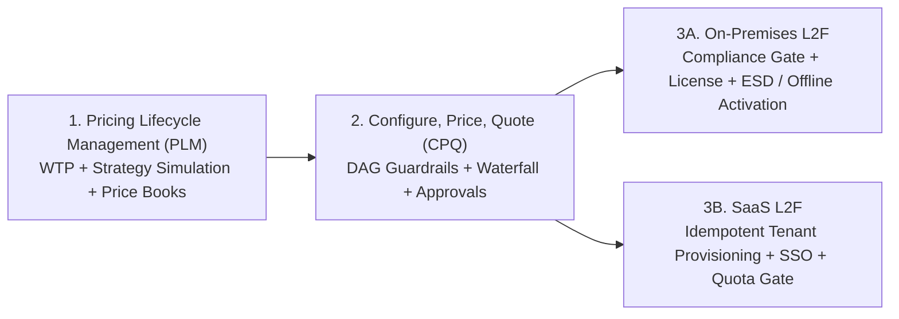

# Commercial & Product Lifecycle UAT / TDD Specifications

Executable **Test-Driven Development (TDD)** and **User Acceptance Testing (UAT)** specifications for **Open CRM/CPQ** commercial product management, pricing strategy simulation, quoting guardrails, and customer fulfillment lifecycles.

These specs sit beside the landed browser UAT runners under [`frontend/e2e/`](../../frontend/e2e/) and the historical Jev local UAT note in this folder. They describe cross-service invariants; they are **not** wired into CI as Playwright suites.

Stack alignment: **Java 25 / Spring Boot 4** microservices behind the gateway, **Angular 22** CRM UI, PostgreSQL/Redis, Drools/configuration-engine rules — see [`docs/ARCHITECTURE.md`](../ARCHITECTURE.md) and [`AGENTS.md`](../../AGENTS.md).

## Specification Suite

| Specification | Scope | Core TDD & UAT Focus |
| :--- | :--- | :--- |
| **[Pricing Lifecycle Management (PLM)](pricing-lifecycle-management.md)** | Strategic portfolio monetization, Van Westendorp WTP modeling, Good/Better/Best packaging fences, **Pricing Strategy Simulation**, pocket-margin leakage audits, and cohort migration. | Seeded cohort replay (`Run A == Run B`), elasticity $\epsilon_d$ guardrails, anti-cannibalization fences, contractual uplift caps (`UAT-PLM-01` – `UAT-PLM-06`). |
| **[CPQ Product Management Lifecycle](cpq-product-management-lifecycle.md)** | Deal-level Configure-Price-Quote workflows, DAG bundle dependencies (`REQUIRES`/`EXCLUDES`), guided selling guardrails, approval routing matrices, and price book waterfalls. | Acyclic DAG write-gate validation, `BigDecimal` pricing waterfalls, ASC 606 SSP penny-exact allocations, snapshot pinning (`UAT-CPQ-01` – `UAT-CPQ-05`). |
| **[On-Premises Lead-to-Fulfillment (L2F)](lead-to-fulfillment-onprem.md)** | End-to-end enterprise self-hosted delivery from technical qualification and PoC sizing to export compliance, cryptographic licensing, and air-gapped deployment. | Hardware-bound licenses, SHA-256/Cosign bundle verification, zero-egress offline activation, HA failover & acceptance sign-off (`UAT-01` – `UAT-06`). |
| **[SaaS Lead-to-Fulfillment (L2F)](lead-to-fulfillment-saas.md)** | Cloud-hosted PLG and Enterprise subscription lifecycle from trial sign-up and checkout to automated multi-tenant provisioning, SSO onboarding, and ratable revenue recognition. | Idempotent webhook provisioning (`< 30s`), zero-loss trial-to-paid upgrades (`< 5s`), strict row/schema tenant isolation, ratable ASC 606 schedules (`UAT-SAAS-01` – `UAT-SAAS-03`). |

## Related local evidence

| Doc / runner | Role |
| :--- | :--- |
| [2026-09-19-JEV-LOCAL-UAT.md](2026-09-19-JEV-LOCAL-UAT.md) | Historical Jev + Playwright local UAT evidence |
| `frontend/e2e/uat-crm-smoke.mjs` | Deterministic CRM smoke |
| `frontend/e2e/uat-jev-local.mjs` | LLM-driven (Jev) browser agent UAT |
| `frontend/e2e/chaos-crm.mjs` | Network/fault injection chaos |

## End-to-End Architecture Flow

---

_Moved from [`drgaciw/cmano-clone`](https://github.com/drgaciw/cmano-clone) `tests/uat/` and reframed for Open CRM/CPQ._
